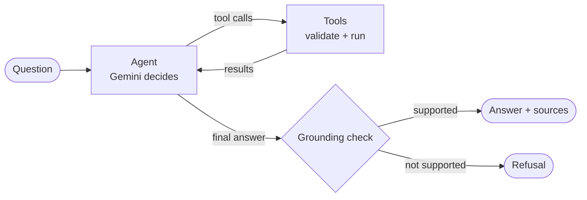

# 🤖 Tech News Agent


An end-to-end **AI news pipeline** that fetches, filters, summarises, and delivers a daily digest of AI & tech news to your inbox — fully automated, scheduled, and containerised — plus a **tool-calling research agent** (LangGraph) that answers questions by deciding which tools to use.

---

## Features

- **Multi-source fetching** — ArXiv, HackerNews, TechCrunch, VentureBeat, Anthropic/OpenAI/DeepMind blogs
- **Smart filtering** — keyword-based relevance scoring across Agentic AI, LLMs, NLP, Singapore tech
- **AI summarisation** — Gemini 2.0 Flash (free tier) generates 2–3 line summaries per article
- **Beautiful HTML email** — styled digest delivered via Gmail SMTP at 11:55 PM SGT daily
- **RAG query interface** — ask questions over stored articles using semantic search + Gemini
- **Research agent** — LangGraph agent that chooses between 4 tools (article search, ArXiv search, summarise, compare), with a tool-call budget, grounding check and step-by-step traces
- **Vector store** — ChromaDB + Sentence Transformers for local semantic search
- **Pipeline metrics** — tracks fetch counts, filter rates, summary success, delivery status
- **Evaluation report** — historical analysis across all runs
- **Fully containerised** — Docker + Kubernetes CronJob ready
- **CI/CD** — GitHub Actions for lint, test, Docker build & push to GHCR

---

## Architecture

```
┌─────────────────────────────────────────────────────┐
│                  Tech News Agent                    │
│                                                     │
│  ┌──────────┐   ┌──────────┐   ┌────────────────┐  │
│  │ Fetcher  │──▶│  Filter  │──▶│  Summariser    │  │
│  │          │   │          │   │  (Gemini 2.0)  │  │
│  │ ArXiv    │   │ Keyword  │   └───────┬────────┘  │
│  │ RSS Feeds│   │ Scoring  │           │           │
│  │ HN/TC/VB │   │ Top N    │   ┌───────▼────────┐  │
│  └──────────┘   └──────────┘   │    Storer      │  │
│                                │  (ChromaDB)    │  │
│                                └───────┬────────┘  │
│  ┌──────────────────────────┐          │           │
│  │  RAG Query Interface     │   ┌───────▼────────┐  │
│  │  query.py                │   │    Emailer     │  │
│  │  Retriever + Gemini      │   │  (Gmail SMTP)  │  │
│  └──────────────────────────┘   └────────────────┘  │
│                                                     │
│  Scheduler: APScheduler / K8s CronJob (11:55 PM SGT)│
└─────────────────────────────────────────────────────┘
```

---

## Tech Stack

| Layer | Technology |
|---|---|
| Language | Python 3.12 |
| AI Summarisation & QA | Google Gemini 2.0 Flash (free tier) |
| News Sources | feedparser, arxiv |
| Vector Store | ChromaDB (local, persistent) |
| Embeddings | Sentence Transformers (all-MiniLM-L6-v2) |
| Email Delivery | Gmail SMTP (smtplib) |
| Scheduling | APScheduler / Kubernetes CronJob |
| Containerisation | Docker (multi-stage build) |
| Orchestration | Kubernetes |
| CI/CD | GitHub Actions |
| Testing | pytest + mocks |
| Linting | ruff |

---

## Quick Start

### 1. Clone & set up virtual environment
```bash
git clone https://github.com/madhumitha-murthy/tech-news-agent.git
cd tech-news-agent
make install
source venv/bin/activate
```

### 2. Configure API keys
```bash
cp .env.example .env
# Edit .env with your keys (see API Keys section below)
```

### 3. Run once (test)
```bash
python main.py
```

### 4. Run on schedule (11:55 PM SGT daily)
```bash
python scheduler.py
```

### 5. Query articles on demand (RAG)
```bash
python query.py
```
```
🤖 Tech News Agent — RAG Query Interface
Type your question or 'quit' to exit.

❓ Ask: what is the latest on agentic AI?

🔍 Searching for: 'what is the latest on agentic AI?'
📚 Found 5 relevant articles

==============================================================
💬 Answer:
==============================================================
Based on recent articles, agentic AI is advancing rapidly [1][2].
Salesforce launched a new Slackbot AI agent [1], while Anthropic
released Cowork, a Claude Desktop agent for file management [2]...

==============================================================
📰 Sources:
==============================================================
[1] Salesforce rolls out new Slackbot AI agent...
    TechCrunch AI | Score: 0.91
    https://techcrunch.com/...
```

---

## Research Agent

The daily pipeline always runs the same five steps. The research agent is different: **the model decides** which tools to call, in what order, and when it has enough to answer.



**Tools** (`research_agent/tools.py`)

| Tool | What it does |
|---|---|
| `search_articles` | Semantic search over articles stored by the daily pipeline (ChromaDB) |
| `search_arxiv` | Live ArXiv search in cs.AI, cs.CL and cs.LG |
| `summarise` | 2–3 sentence summary with Gemini |
| `compare_articles` | Fetches 2–3 stored articles by title, side by side |

**Run it**

```bash
python main.py                                   # fill the vector store first
python -m research_agent.run "What's new in AI agents this week?"
```

Each run prints the tools called, the answer and its sources, and saves a full trace to `results/traces/`.

**Evaluate it**

```bash
python -m eval.run_eval      # 20 questions in eval/questions.json
```

Writes `results/metrics.json` and `results/eval_details.csv`: grounded-answer rate, correct-refusal rate on out-of-scope questions, tool-selection accuracy, average tool calls and latency. These measure behaviour; the CSV includes every answer for checking correctness by hand.

**Design decisions**

- **Explicit LangGraph graph, not a prebuilt agent:** every node (agent, tools, grounding) is visible and testable.
- **Our code runs the tools, not the SDK:** each call is validated against its schema, errors go back to the model instead of crashing, and every step is traced.
- **Tool-call budget (6):** stops runaway loops and cost; once spent, the model must answer from what it has.
- **Grounding check:** each answer sentence is compared with the retrieved sources using the same embedding model as the vector store; answers with too little support are replaced by a refusal. This is a cheap proxy, not a fact-checker.
- **Tests without API calls:** `tests/test_research_agent.py` uses a scripted fake model to test the loop, the budget, tool errors and refusals.

**Results:** run `python -m eval.run_eval` and see `results/metrics.json`.

---

## API Keys Setup

| Key | Where to get | Cost |
|---|---|---|
| `GEMINI_API_KEY` | [aistudio.google.com](https://aistudio.google.com/app/apikey) | Free |
| `GMAIL_ADDRESS` | Your Gmail address | Free |
| `GMAIL_APP_PASSWORD` | Google Account → Security → 2FA → App Passwords | Free |
| `RECIPIENT_EMAIL` | Email to receive the digest | Free |

---

## Docker

```bash
# Build
make docker-build

# Run with scheduler
make docker-run

# Or with docker-compose
make docker-compose-up

# Run pipeline once
docker-compose --profile run-once up tech-news-agent-run-once
```

---

## Kubernetes Deployment

```bash
# 1. Encode your secrets
echo -n "your_api_key" | base64

# 2. Edit k8s/secret.yaml with encoded values

# 3. Apply manifests
kubectl apply -f k8s/configmap.yaml
kubectl apply -f k8s/secret.yaml
kubectl apply -f k8s/cronjob.yaml

# 4. Verify
kubectl get cronjobs
kubectl create job --from=cronjob/tech-news-agent test-run
```

---

## Metrics & Evaluation

Every pipeline run saves a JSON metrics log to `metrics/data/`.

```bash
# View evaluation across all runs
python -m metrics.evaluator
```

Sample output:
```
==================================================
PIPELINE EVALUATION REPORT
==================================================
  Total runs        : 7
  Success rate      : 100.0%
  Avg articles/run  : 14.3
  Avg duration      : 42.1s
  Avg summary rate  : 96.8%
==================================================
```

---

## Testing

```bash
make test          # run all tests
make lint          # lint with ruff
make format        # auto-format
```

---

## Project Structure

```
tech-news-agent/
├── agents/
│   ├── fetcher.py          # fetch from ArXiv & RSS feeds
│   ├── filter.py           # keyword scoring & ranking
│   ├── summariser.py       # Gemini 2.0 Flash summarisation
│   ├── storer.py           # embed & store articles in ChromaDB
│   ├── retriever.py        # semantic search over stored articles
│   └── emailer.py          # HTML email via Gmail SMTP
├── vectorstore/            # persistent ChromaDB vector store
├── query.py                # RAG query CLI interface
├── metrics/
│   ├── tracker.py          # per-run metrics collection
│   ├── evaluator.py        # historical evaluation report
│   └── data/               # saved JSON run logs
├── tests/
│   ├── test_filter.py
│   ├── test_summariser.py
│   ├── test_emailer.py
│   └── test_metrics.py
├── k8s/
│   ├── cronjob.yaml        # k8s CronJob (11:55 PM SGT)
│   ├── configmap.yaml
│   └── secret.yaml
├── .github/workflows/
│   ├── ci.yml              # lint + test on every PR
│   └── cd.yml              # build + push Docker on merge
├── config.py               # all settings
├── main.py                 # pipeline orchestrator
├── scheduler.py            # APScheduler daily runner
├── Dockerfile              # multi-stage production build
├── docker-compose.yml
├── Makefile
└── requirements.txt
```

---

## Roadmap

- [ ] Reddit source integration
- [ ] Telegram bot delivery option
- [ ] Web dashboard for metrics visualisation
- [ ] Personalisation based on reading history
- [ ] Integration with job hunting agent

---

## Author

**Madhumitha Murthy** — MSc EEE, NTU Singapore
ML/AI Engineer | NLP | Agentic AI

[](https://github.com/madhumitha-murthy)
